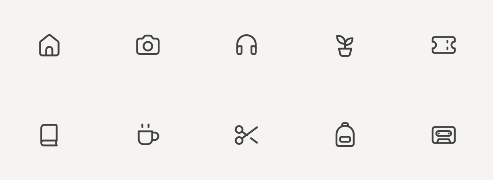

# Make Icons

A coding-agent skill for making cohesive, editable SVG icons. Clean contours, natural proportions, restrained rounding, and clear negative space.



[Skill](SKILL.md) · [Prompt](references/master-prompt.md) · [Sample Pack](make-icons-samples.zip)

## Install

Install with the Skills CLI:

```bash
npx skills add chairs44/make-icons --skill make-icons
```

Or copy this repository into your agent’s skills directory as `make-icons/`. Keep `SKILL.md`, `references/`, `scripts/`, and `assets/` together.

For a chat-only workflow, copy the complete [standalone prompt](references/master-prompt.md) and fill in the inputs at the beginning. It includes the drawing and delivery rules without requiring the installed skill.

## Use

Tell your agent which icons you need, where they will be used, and any formats or references that matter:

```text
Use make-icons to create an outline SVG set for a reading app:
book, bookmark, headphones, reading lamp, and library shelf.
Use a 24-unit grid and review the set at 16, 20, 24, and 32px.
Deliver editable SVGs and a self-contained comparison specimen.
```

A single icon is a complete request. Optional inputs can stay blank. The default package contains SVGs, an HTML specimen, a README, a manifest, and a ZIP for a set. Narrow requests such as SVG-only or a Paper study keep their requested scope.

Ask for solid companions, compact native 16/20-unit masters, or framework components when needed. Supported export choices include React, Vue, SolidJS, React Native, Astro, expanded SVG, and PNG. These are agent workflows, not automatic converters in the bundled scripts. Expanded outlines keep the outline appearance; they are not solid icons or SolidJS components.

## Drawing system

The default is a 24-unit outline family with a 1.5-unit stroke. The [construction guide](references/construction.md) explains how to apply that family across subjects:

- Preserve characteristic proportions, long structural edges, and short deliberate corner transitions.
- Shape organic forms with flowing curves and purposeful taper.
- Plan shared edges, crossings, and modifiers so contours stay readable without doubled lines or crowded intersections.

The rules define a drawing approach, not a fixed catalogue. Supplied references and an established project system take precedence. Visual review is necessary; no script certifies artistic quality.

| Property | Default |
| --- | --- |
| Native canvas | `viewBox="0 0 24 24"` |
| Outline weight | 1.5 units; round exposed caps and joins unless the form needs an exception |
| Working area | Nominal visible bounds 2–22, with shape-specific proportions and optical corrections |
| Corners | About 2 units for broad structural corners; shorter transitions and tapered tips where appropriate |
| Openings | Measure between painted edges, including cap and stroke extents |
| Colour | `currentColor`; transparent negative space |
| Review | 16/20/24/32px displays, enlarged contours, and light/dark contexts |
| Compact sizes | Separate native drawings when requested; resized previews are not optical variants |

## Samples and tools

The [ten sample SVGs](samples/svg/24/) are the exact drawings in the banner and [sample ZIP](make-icons-samples.zip). Their editable construction copies live in [assets/outline-24/](assets/outline-24/). The [reference guide](references/anchors.md) describes what each demonstrates.

Download [preview.html](samples/preview.html) and open it locally to inspect actual-size samples. Cassette reel details and narrow handle openings are least distinct at 16px; evaluate them in the intended UI before adopting that size.

Inline SVGs inherit CSS `color`. For SVG files used as images, set the foreground in the file. Label icon-only controls on their parent button or link; provide accessible text for meaningful standalone images.

The helpers use Python 3.10+ and its standard library. Delivered SVGs have no runtime dependencies. Creating new artwork requires a coding agent; a browser is useful for rendered review.

```bash
python3 scripts/specimen.py ./my-icons --output ./specimen.html
```

For a packaged delivery, keep the SVG directory and optional included files inside the delivery folder; see the [packaging example](references/anchors.md#specimen-helper).

| File | Purpose |
| --- | --- |
| [SKILL.md](SKILL.md) | Agent workflow and supporting-document routes |
| [references/master-prompt.md](references/master-prompt.md) | Self-contained prompt, inputs, specifications, and export contract |
| [references/construction.md](references/construction.md) | Contour, proportion, and optical construction rules |
| [scripts/geometry.py](scripts/geometry.py) | Exact circular corners for polygons |
| [scripts/specimen.py](scripts/specimen.py) | SVG structure checks, comparison HTML, manifest, and ZIP assembly |
| [scripts/validate.py](scripts/validate.py) | Package consistency checks |

The specimen helper checks XML and supported structure, not path correctness, optical balance, or accessibility of an application. Run `python3 scripts/validate.py` from this repository to check the shipped package. Inspect rendered artwork separately after geometry changes and regenerate affected previews, images, and archives together.

## License

MIT. See [LICENSE](LICENSE). The skill, helpers, and original sample icons may be used personally or commercially under that license.
